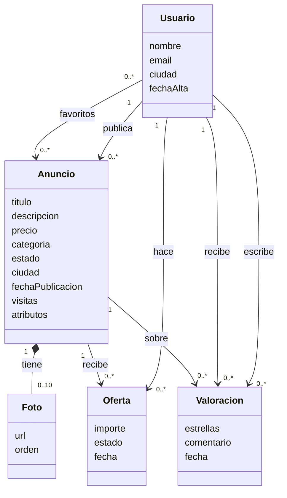

# Entrega: MongoDB — Diseña la base de datos de una app de segunda mano

## Objetivo

En la entrega del gimnasio aprendiste a pensar **en tablas**: dónde va cada clave ajena. Ahora vas a pensar **en documentos**: qué va dentro de qué.

Al terminar deberías poder:

- Explicar **por qué** MongoDB encaja en un problema concreto, y cuándo no.
- Leer un diagrama de clases y convertirlo en **colecciones y documentos**.
- Decidir si un dato va **embebido** o **referenciado**, y justificarlo.
- Entender qué es **desnormalizar** (copiar datos) y qué cuesta.
- Comprobar qué protege MongoDB (índices únicos) y qué **no** protege (las referencias).
- Consultar, modificar y agregar datos con `mongosh`.

**Tiempo orientativo:** 3–4 horas.

**Qué vas a entregar:** un archivo `rastro.js` y un archivo `respuestas.md` (detalles en el apartado [Entrega](#entrega)).

**Cómo trabajarla:**

- Haz la **Parte A** (pensar) antes de tocar MongoDB. Es la parte más importante.
- Responde cada pregunta **antes** de seguir leyendo: los apartados siguientes van dando pistas.
- Ten a mano la chuleta de MongoDB.
- Lo que cuenta es que sepas explicar **por qué**. En diseño de documentos casi nunca hay una única respuesta correcta.

---

## 0. El problema

**Rastro** es una app para comprar y vender cosas de segunda mano en la Comunitat Valenciana. Este es su diagrama de clases:



Lo que el diagrama no dice:

- **Usuario:** no puede haber dos usuarios con el mismo email.
- **Anuncio:** `estado` es `DISPONIBLE`, `RESERVADO` o `VENDIDO`. `visitas` cuenta cuántas veces se ha visto.
- **Atributos:** cada categoría tiene sus propios datos:

| Categoría | Atributos |
|---|---|
| Coches | marca, modelo, año, km, combustible |
| Móviles | marca, modelo, almacenamiento (GB), batería (%) |
| Ropa | talla, marca, género |
| Muebles | material, ancho, fondo, alto (cm) |

  Y el equipo quiere añadir categorías nuevas (Deporte, Libros…) sin parar la app.
- **Foto:** cada anuncio tiene de 0 a 10 fotos. Una foto es de un solo anuncio y no tiene sentido sin él (por eso el rombo negro, la composición).
- **Oferta:** un comprador ofrece un importe por un anuncio. `estado` es `PENDIENTE`, `ACEPTADA` o `RECHAZADA`. El comprador quiere ver la lista de «mis ofertas»; el vendedor, las ofertas de cada anuncio.
- **Valoración:** cuando se cierra una venta, el comprador valora al vendedor (1 a 5 estrellas). Un usuario solo puede valorar **una vez** cada compra. En el perfil de cada usuario se ve su nota media.
- **Favoritos:** un usuario guarda anuncios en favoritos. Un anuncio muy popular puede estar en los favoritos de miles de usuarios.
- **La pantalla más usada** es la ficha de un anuncio: título, precio, fotos, atributos y el nombre del vendedor. Se abre millones de veces al día.

Vuelve a esta página cada vez que tengas una duda sobre el diseño.

---

# PARTE A — Pensar antes de escribir código

## 1. ¿Por qué MongoDB aquí?

Vamos a intentar guardar los anuncios en **una tabla SQL**. Estos son cuatro anuncios:

| Anuncio | Categoría | Datos propios |
|---|---|---|
| Seat Ibiza | Coches | marca Seat, modelo Ibiza, año 2015, 98.000 km, gasolina |
| iPhone 13 | Móviles | marca Apple, modelo iPhone 13, 128 GB, batería 87 % |
| Chaqueta vaquera | Ropa | talla M, marca Levi's, unisex |
| Mesa de comedor | Muebles | roble, 160 × 90 × 75 cm |

### Ejercicio A1

1. Escribe las columnas que tendría la tabla `anuncios` si cada atributo es una columna. Cuéntalas.
2. Rellena la fila de la chaqueta. ¿Cuántas columnas quedan en `NULL`?
3. Mañana llega la categoría **Deporte** (talla, tipo de bici, pulgadas de rueda). ¿Qué tendrías que cambiar en la base de datos?
4. Otra opción en SQL: una tabla por categoría (`coches`, `moviles`…), cada una con `anuncio_id`. ¿Cuántos `JOIN` harían falta para listar «todos los anuncios de Valencia con sus datos»?

Ahora el mismo problema en MongoDB. Cada anuncio es un documento, y `atributos` es un **objeto distinto en cada uno**:

```javascript
{ titulo: "Seat Ibiza 2015", categoria: "Coches", precio: 6500,
  atributos: { marca: "Seat", modelo: "Ibiza", anio: 2015, km: 98000, combustible: "gasolina" } }

{ titulo: "Chaqueta vaquera Levi's", categoria: "Ropa", precio: 25,
  atributos: { talla: "M", marca: "Levi's", genero: "unisex" } }
```

Ni una columna vacía. Y una categoría nueva no exige cambiar nada: el primer anuncio de Deporte llega con sus propios atributos.

5. Escribe el documento del iPhone y el de la mesa.

### Las razones de esta elección

Para Rastro elegimos MongoDB por tres motivos que salen **del problema**, no de una moda:

| Motivo | En Rastro |
|---|---|
| Datos con forma distinta | Cada categoría tiene atributos distintos, y salen categorías nuevas |
| Se lee «de una pieza» | La ficha del anuncio (fotos, atributos, vendedor) se pide millones de veces: mejor un solo documento que cinco `JOIN` |
| Pocas relaciones entre muchas tablas | Lo importante es el anuncio; lo demás gira a su alrededor |

Y cuándo **no** lo elegiríamos: si Rastro gestionara pagos, facturas y saldos, esa parte iría mejor en SQL. Ahí la estructura es fija, los datos están muy relacionados y la base de datos debe impedir cualquier dato incoherente.

---

## 2. Las preguntas para embeber o referenciar

En SQL la pregunta era «¿en qué tabla va la clave ajena?». En MongoDB es **«¿esto va dentro, o aparte?»**.

| Pregunta | Si la respuesta es sí… |
|---|---|
| ¿Cuando leo A, casi siempre necesito B? | Embeber B en A |
| ¿B pertenece solo a A y no tiene sentido sin él? | Embeber |
| ¿B se comparte entre muchos A, o se consulta solo? | Referenciar |
| ¿B puede crecer sin límite (miles)? | Referenciar |

Un documento de MongoDB tiene un **tamaño máximo de 16 MB**. Un array que crece sin límite acaba siendo un problema.

---

## 3. Ejemplo resuelto: anuncio y fotos

Primero lo hacemos «a lo SQL»: una colección `fotos` y cada foto apunta a su anuncio.

```javascript
// colección anuncios
{ _id: ObjectId("670000000000000000000003"), titulo: "iPhone 13 128 GB", precio: 380 }

// colección fotos
{ anuncioId: ObjectId("670000000000000000000003"), url: "https://img.rastro.es/a3-1.jpg", orden: 1 }
{ anuncioId: ObjectId("670000000000000000000003"), url: "https://img.rastro.es/a3-2.jpg", orden: 2 }
```

Funciona, pero cada vez que se abre la ficha hay que hacer **dos consultas**: el anuncio y sus fotos. Y la ficha se abre millones de veces.

Las preguntas:

- ¿Cuando leo el anuncio, necesito las fotos? → **Siempre.**
- ¿Una foto tiene sentido sin su anuncio? → **No.**
- ¿Pueden ser miles? → **No, máximo 10.**

Tres respuestas a favor de **embeber**:

```javascript
{
  _id: ObjectId("670000000000000000000003"),
  titulo: "iPhone 13 128 GB",
  precio: 380,
  fotos: [
    { url: "https://img.rastro.es/a3-1.jpg", orden: 1 },
    { url: "https://img.rastro.es/a3-2.jpg", orden: 2 }
  ]
}
```

Una consulta, todo junto. Y ya no hace falta `anuncioId` en cada foto: están **dentro** del anuncio.

Fíjate en el diagrama: el rombo negro (composición) entre Anuncio y Foto ya te avisaba. «Es parte de» suele significar «embébelo».

---

## 4. Ejemplo resuelto: anuncio y vendedor

¿Embebemos el usuario completo dentro de cada anuncio?

- ¿Cuando leo el anuncio, necesito al vendedor? → Solo **su nombre**.
- ¿El usuario pertenece solo a ese anuncio? → **No.** Luis tiene varios anuncios, hace ofertas, escribe valoraciones…
- Si Luis cambia su email, ¿en cuántos sitios habría que cambiarlo? → En **todos** sus anuncios.

El usuario tiene vida propia: va en su colección `usuarios`, y el anuncio lo **referencia** con su `_id`, como una clave ajena.

Pero entonces, para pintar «Vendido por Luis Martín» en la ficha, haría falta una segunda consulta a `usuarios`. La solución habitual: **guardar el id y copiar el nombre**.

```javascript
{
  titulo: "Seat Ibiza 2015",
  precio: 6500,
  vendedor: {
    id: ObjectId("660000000000000000000002"),   // referencia: para ir a su perfil
    nombre: "Luis Martín"                         // copia: para pintar la ficha sin otra consulta
  }
}
```

Copiar datos de otro documento se llama **desnormalizar**. En SQL lo evitábamos a toda costa. En MongoDB es habitual, pero tiene un precio: si Luis cambia su nombre, hay que actualizarlo también en sus anuncios. Por eso solo se copia lo **imprescindible** y que **cambia poco**: el nombre sí, el email no.

### Ejercicio A2

1. ¿Por qué no embebemos el usuario completo dentro del anuncio? Da dos razones.
2. ¿Por qué copiamos el nombre del vendedor y no su email ni su ciudad?
3. Si Luis cambia su nombre, ¿qué documentos hay que actualizar?
4. En el gimnasio de SQL, ¿cómo se resolvía «mostrar el nombre del monitor de cada clase»? ¿Qué cambia aquí?

---

## 5. Ahora tú: ofertas

### Ejercicio A3

Recuerda: el comprador quiere ver «mis ofertas», el vendedor las de cada anuncio, y un anuncio popular puede recibir muchas.

1. Haz las preguntas del apartado 2. ¿Embebes las ofertas en el anuncio o creas una colección `ofertas`?
2. Escribe un documento de oferta de ejemplo: Sara (`660000000000000000000005`) ofrece 340 € por el iPhone.
3. Cuando Sara abre «mis ofertas», quiere ver el **título** del anuncio y el **precio que pedían**, sin abrir el anuncio. ¿Qué copiarías dentro de la oferta?
4. Si mañana Ana baja el precio del iPhone a 350 €, ¿debe cambiar el precio guardado en la oferta? ¿Por qué? (Pista: piensa en el precio de una línea de pedido de Furniro.)

---

## 6. Ahora tú: valoraciones

### Ejercicio A4

1. ¿Embebes las valoraciones dentro del usuario valorado, o colección aparte? Justifícalo.
2. Escribe un documento de valoración: Hugo (`660000000000000000000004`) valora con 5 estrellas a Marta (`660000000000000000000003`) por el anuncio `670000000000000000000004`, comentario «Todo perfecto».
3. Un usuario solo puede valorar **una vez** cada compra. En SQL pondrías un `UNIQUE (…, …)`. ¿Sobre qué dos campos crearías un **índice único** en MongoDB?
4. El perfil muestra la **nota media** del usuario. Calcularla cada vez recorriendo todas sus valoraciones es lento. ¿Qué dos campos guardarías en el documento del usuario para mostrarla al momento?

---

## 7. La relación N:M: favoritos

En SQL, una N:M **siempre** era una tabla intermedia. En MongoDB hay tres opciones:

| Opción | Cómo queda |
|---|---|
| a) Array de anuncios en el usuario | `usuario.favoritos: [idAnuncio1, idAnuncio2]` |
| b) Array de usuarios en el anuncio | `anuncio.favoritoDe: [idUsuario1, idUsuario2, …]` |
| c) Colección intermedia | `favoritos: { usuarioId, anuncioId }`, como en SQL |

### Ejercicio A5

1. Un usuario normal, ¿cuántos favoritos tendrá? ¿Y cuántos usuarios pueden tener en favoritos un anuncio popular?
2. Con eso, descarta una de las tres opciones y explica por qué.
3. La pantalla «Mis favoritos» es de las más usadas. ¿Qué opción la hace más fácil?
4. Con la opción a), ¿cómo sabrías cuántos usuarios tienen un anuncio en favoritos? (Pista: un filtro sobre un array encuentra los documentos que **contienen** ese valor.)
5. ¿Qué operador usarías para añadir un favorito sin que se repita si el usuario pulsa dos veces?

---

## 8. Entrenamiento: ¿dentro o aparte?

### Ejercicio A6

Para cada caso, di si embeberías o referenciarías, y por qué en una frase. Si embebes, di **dónde**.

1. Los mensajes de chat entre comprador y vendedor sobre un anuncio.
2. La dirección de envío de una compra.
3. Las etiquetas de un anuncio (`["urgente", "negociable"]`).
4. Las categorías, si cada una tiene nombre, icono y lista de atributos obligatorios.
5. El historial de cambios de precio de un anuncio (fecha y precio).
6. Los anuncios de un usuario, dentro del documento del usuario.
7. **Furniro:** las líneas de un pedido.
8. **Furniro:** las reseñas de un producto.

---

## 9. El modelo completo

Compara tu diseño con este. Es el que usaremos en la Parte B. Si el tuyo es distinto, no pasa nada: anota en `respuestas.md` en qué se diferencia y por qué elegiste lo tuyo.

```text
usuarios     { _id, nombre, email (único), ciudad, fechaAlta,
               favoritos: [idAnuncio, ...],
               valoracionMedia, numValoraciones }

anuncios     { _id, titulo, descripcion, precio, categoria, estado, ciudad,
               fechaPublicacion, visitas,
               vendedor: { id, nombre },
               fotos: [ { url, orden } ],
               atributos: { ...distintos según la categoría... } }

ofertas      { _id, importe, estado, fecha,
               anuncio:   { id, titulo, precio },
               comprador: { id, nombre } }

valoraciones { _id, anuncioId, autor: { id, nombre }, valoradoId,
               estrellas, comentario, fecha }
               índice único (autor.id, anuncioId)
```

Cuatro colecciones. En SQL habrían salido al menos ocho tablas: usuarios, anuncios, fotos, ofertas, valoraciones, favoritos y una por categoría.

| Relación del diagrama | Decisión |
|---|---|
| Anuncio – Foto | Embebida (array `fotos`) |
| Usuario – Anuncio | Referencia en el anuncio + nombre copiado |
| Anuncio – Oferta, Usuario – Oferta | Colección `ofertas` con las dos referencias y datos copiados |
| Valoración | Colección `valoraciones` + resumen (`valoracionMedia`) en el usuario |
| Favoritos (N:M) | Array de ids en el usuario |

---

# PARTE B — Construirlo en MongoDB

Escribe **todo** lo que ejecutes en un archivo `rastro.js`, con un comentario `// Ejercicio B…` antes de cada parte. Puedes copiar y pegar desde el archivo a `mongosh`.

## 10. Prepara la base de datos

Arranca el contenedor de la clase y entra en `mongosh`:

```bash
docker compose up -d
docker exec -it mongodb-practica mongosh -u admin -p admin_dev_123 --authenticationDatabase admin
```

```javascript
use rastro
```

**Script de reinicio.** Si en algún momento quieres empezar de cero, ejecuta esto y vuelve a cargar los datos del apartado 11:

```javascript
use rastro
db.dropDatabase()
```

## 11. Carga los datos

Los `_id` van escritos a mano para que las referencias funcionen igual en todos los ordenadores. Los usuarios empiezan por `66…`, los anuncios por `67…`, las ofertas por `68…`.

### Ejercicio B1

Copia y ejecuta:

```javascript
db.usuarios.insertMany([
  { _id: ObjectId("660000000000000000000001"), nombre: "Ana García",  email: "ana@rastro.es",   ciudad: "Valencia",  fechaAlta: new Date("2025-03-10"), favoritos: [ObjectId("670000000000000000000008")], valoracionMedia: 0, numValoraciones: 0 },
  { _id: ObjectId("660000000000000000000002"), nombre: "Luis Martín", email: "luis@rastro.es",  ciudad: "Valencia",  fechaAlta: new Date("2024-11-02"), favoritos: [], valoracionMedia: 0, numValoraciones: 0 },
  { _id: ObjectId("660000000000000000000003"), nombre: "Marta Ruiz",  email: "marta@rastro.es", ciudad: "Alicante",  fechaAlta: new Date("2025-06-21"), favoritos: [], valoracionMedia: 5, numValoraciones: 1 },
  { _id: ObjectId("660000000000000000000004"), nombre: "Hugo Sanz",   email: "hugo@rastro.es",  ciudad: "Castellón", fechaAlta: new Date("2026-01-15"), favoritos: [], valoracionMedia: 0, numValoraciones: 0 },
  { _id: ObjectId("660000000000000000000005"), nombre: "Sara López",  email: "sara@rastro.es",  ciudad: "Valencia",  fechaAlta: new Date("2026-09-30"), favoritos: [ObjectId("670000000000000000000001"), ObjectId("670000000000000000000003"), ObjectId("670000000000000000000008")], valoracionMedia: 0, numValoraciones: 0 }
])

db.anuncios.insertMany([
  { _id: ObjectId("670000000000000000000001"), titulo: "Seat Ibiza 2015", descripcion: "Siempre en garaje, ITV pasada.", precio: 6500, categoria: "Coches", estado: "DISPONIBLE", ciudad: "Valencia", fechaPublicacion: new Date("2026-10-01"), visitas: 340,
    vendedor: { id: ObjectId("660000000000000000000002"), nombre: "Luis Martín" },
    fotos: [ { url: "https://img.rastro.es/a1-1.jpg", orden: 1 }, { url: "https://img.rastro.es/a1-2.jpg", orden: 2 } ],
    atributos: { marca: "Seat", modelo: "Ibiza", anio: 2015, km: 98000, combustible: "gasolina" } },
  { _id: ObjectId("670000000000000000000002"), titulo: "Ford Focus 2012", descripcion: "Correa cambiada hace un año.", precio: 4200, categoria: "Coches", estado: "DISPONIBLE", ciudad: "Castellón", fechaPublicacion: new Date("2026-10-12"), visitas: 95,
    vendedor: { id: ObjectId("660000000000000000000004"), nombre: "Hugo Sanz" },
    fotos: [ { url: "https://img.rastro.es/a2-1.jpg", orden: 1 } ],
    atributos: { marca: "Ford", modelo: "Focus", anio: 2012, km: 165000, combustible: "diésel" } },
  { _id: ObjectId("670000000000000000000003"), titulo: "iPhone 13 128 GB", descripcion: "Con funda y cargador.", precio: 380, categoria: "Móviles", estado: "DISPONIBLE", ciudad: "Valencia", fechaPublicacion: new Date("2026-10-20"), visitas: 512,
    vendedor: { id: ObjectId("660000000000000000000001"), nombre: "Ana García" },
    fotos: [ { url: "https://img.rastro.es/a3-1.jpg", orden: 1 }, { url: "https://img.rastro.es/a3-2.jpg", orden: 2 }, { url: "https://img.rastro.es/a3-3.jpg", orden: 3 } ],
    atributos: { marca: "Apple", modelo: "iPhone 13", almacenamientoGB: 128, bateriaPct: 87 } },
  { _id: ObjectId("670000000000000000000004"), titulo: "Samsung Galaxy A52", descripcion: "Pantalla sin rayas.", precio: 150, categoria: "Móviles", estado: "VENDIDO", ciudad: "Alicante", fechaPublicacion: new Date("2026-09-05"), visitas: 210,
    vendedor: { id: ObjectId("660000000000000000000003"), nombre: "Marta Ruiz" },
    fotos: [ { url: "https://img.rastro.es/a4-1.jpg", orden: 1 } ],
    atributos: { marca: "Samsung", modelo: "Galaxy A52", almacenamientoGB: 128, bateriaPct: 80 } },
  { _id: ObjectId("670000000000000000000005"), titulo: "Xiaomi Redmi Note 10", descripcion: "Funciona perfecto.", precio: 90, categoria: "Móviles", estado: "DISPONIBLE", ciudad: "Valencia", fechaPublicacion: new Date("2026-10-22"), visitas: 48,
    vendedor: { id: ObjectId("660000000000000000000002"), nombre: "Luis Martín" },
    fotos: [ { url: "https://img.rastro.es/a5-1.jpg", orden: 1 } ],
    atributos: { marca: "Xiaomi", modelo: "Redmi Note 10", almacenamientoGB: 64, bateriaPct: 91 } },
  { _id: ObjectId("670000000000000000000006"), titulo: "Chaqueta vaquera Levi's", descripcion: "Poco uso.", precio: 25, categoria: "Ropa", estado: "DISPONIBLE", ciudad: "Alicante", fechaPublicacion: new Date("2026-10-25"), visitas: 12,
    vendedor: { id: ObjectId("660000000000000000000003"), nombre: "Marta Ruiz" },
    fotos: [],
    atributos: { talla: "M", marca: "Levi's", genero: "unisex" } },
  { _id: ObjectId("670000000000000000000007"), titulo: "Zapatillas Nike Air", descripcion: "Talla 42, como nuevas.", precio: 40, categoria: "Ropa", estado: "RESERVADO", ciudad: "Valencia", fechaPublicacion: new Date("2026-10-18"), visitas: 77,
    vendedor: { id: ObjectId("660000000000000000000001"), nombre: "Ana García" },
    fotos: [ { url: "https://img.rastro.es/a7-1.jpg", orden: 1 } ],
    atributos: { talla: "42", marca: "Nike", genero: "hombre" } },
  { _id: ObjectId("670000000000000000000008"), titulo: "Mesa de comedor de roble", descripcion: "Para 6 personas.", precio: 120, categoria: "Muebles", estado: "DISPONIBLE", ciudad: "Castellón", fechaPublicacion: new Date("2026-10-26"), visitas: 160,
    vendedor: { id: ObjectId("660000000000000000000004"), nombre: "Hugo Sanz" },
    fotos: [ { url: "https://img.rastro.es/a8-1.jpg", orden: 1 } ],
    atributos: { material: "roble", ancho: 160, fondo: 90, alto: 75 } }
])

db.ofertas.insertMany([
  { _id: ObjectId("680000000000000000000001"), importe: 340, estado: "PENDIENTE", fecha: new Date("2026-10-27"),
    anuncio: { id: ObjectId("670000000000000000000003"), titulo: "iPhone 13 128 GB", precio: 380 },
    comprador: { id: ObjectId("660000000000000000000005"), nombre: "Sara López" } },
  { _id: ObjectId("680000000000000000000002"), importe: 6000, estado: "RECHAZADA", fecha: new Date("2026-10-05"),
    anuncio: { id: ObjectId("670000000000000000000001"), titulo: "Seat Ibiza 2015", precio: 6500 },
    comprador: { id: ObjectId("660000000000000000000001"), nombre: "Ana García" } },
  { _id: ObjectId("680000000000000000000003"), importe: 6200, estado: "PENDIENTE", fecha: new Date("2026-10-26"),
    anuncio: { id: ObjectId("670000000000000000000001"), titulo: "Seat Ibiza 2015", precio: 6500 },
    comprador: { id: ObjectId("660000000000000000000005"), nombre: "Sara López" } },
  { _id: ObjectId("680000000000000000000004"), importe: 150, estado: "ACEPTADA", fecha: new Date("2026-09-10"),
    anuncio: { id: ObjectId("670000000000000000000004"), titulo: "Samsung Galaxy A52", precio: 150 },
    comprador: { id: ObjectId("660000000000000000000004"), nombre: "Hugo Sanz" } },
  { _id: ObjectId("680000000000000000000005"), importe: 35, estado: "ACEPTADA", fecha: new Date("2026-10-27"),
    anuncio: { id: ObjectId("670000000000000000000007"), titulo: "Zapatillas Nike Air", precio: 40 },
    comprador: { id: ObjectId("660000000000000000000002"), nombre: "Luis Martín" } }
])

db.valoraciones.insertOne({
  anuncioId: ObjectId("670000000000000000000004"),
  autor: { id: ObjectId("660000000000000000000004"), nombre: "Hugo Sanz" },
  valoradoId: ObjectId("660000000000000000000003"),
  estrellas: 5, comentario: "Todo perfecto", fecha: new Date("2026-09-15")
})
```

Comprueba que hay 5 usuarios, 8 anuncios, 5 ofertas y 1 valoración con `countDocuments()`.

### Ejercicio B2 — Ahora tú: dos anuncios nuevos

Escribe tú los dos `insertOne`. No les pongas `_id`: deja que MongoDB lo genere.

| | Anuncio 1 | Anuncio 2 |
|---|---|---|
| Título | Bicicleta de montaña Orbea | Google Pixel 7 |
| Descripción | Revisada en taller. | Libre, con caja. |
| Precio | 300 | 260 |
| Categoría | Deporte | Móviles |
| Estado | DISPONIBLE | DISPONIBLE |
| Ciudad | Castellón | Valencia |
| Fecha | 2026-10-27 | 2026-10-28 |
| Visitas | 0 | 0 |
| Vendedor | Hugo Sanz | Sara López |
| Fotos | `https://img.rastro.es/bici-1.jpg` | `https://img.rastro.es/pixel-1.jpg` y `https://img.rastro.es/pixel-2.jpg` |
| Atributos | talla L, tipo montaña, 29 pulgadas de rueda | marca Google, modelo Pixel 7, 128 GB, batería 92 % |

**Pregunta B2.3:** «Deporte» es una categoría que no existía. ¿Has tenido que cambiar algo antes de insertar? ¿Qué habría pasado en PostgreSQL?

## 12. Índices: lo que MongoDB sí protege

### Ejercicio B3

1. Crea un índice único sobre el `email` de `usuarios`.
2. Crea un índice único sobre la pareja `autor.id` + `anuncioId` de `valoraciones`.
3. La búsqueda más habitual es «anuncios de una categoría ordenados por precio». Crea un índice sobre `categoria` y `precio`.
4. Muestra los índices de las tres colecciones.
5. Comprueba con `explain()` que `db.anuncios.find({ categoria: "Coches" }).sort({ precio: 1 })` usa el índice.

## 13. Rompe la base de datos a propósito

En el gimnasio, las claves ajenas impedían guardar datos incoherentes. Vamos a ver qué hace MongoDB.

### Ejercicio B4

Para cada instrucción:

1. **Antes de ejecutarla**, escribe en `respuestas.md` qué crees que pasará y por qué.
2. Ejecútala.
3. Si da error, copia la línea importante y di **qué** lo ha impedido. Si no da error, explica si el resultado es un problema.

```javascript
// B4.1 Un usuario con el email de Ana
db.usuarios.insertOne({ nombre: "Ana Copia", email: "ana@rastro.es", ciudad: "Valencia", fechaAlta: new Date(), favoritos: [], valoracionMedia: 0, numValoraciones: 0 })

// B4.2 Hugo valora otra vez a Marta por el mismo anuncio
db.valoraciones.insertOne({ anuncioId: ObjectId("670000000000000000000004"), autor: { id: ObjectId("660000000000000000000004"), nombre: "Hugo Sanz" }, valoradoId: ObjectId("660000000000000000000003"), estrellas: 1, comentario: "Cambio de opinión", fecha: new Date() })

// B4.3 Un anuncio de un vendedor que no existe
db.anuncios.insertOne({ titulo: "Prueba fantasma", precio: 10, categoria: "Libros", estado: "DISPONIBLE", ciudad: "Valencia", fechaPublicacion: new Date(), visitas: 0, vendedor: { id: ObjectId("660000000000000000000099"), nombre: "Nadie" }, fotos: [], atributos: {} })

// B4.4 Un anuncio con el precio escrito como texto
db.anuncios.insertOne({ titulo: "Prueba lámpara", precio: "75", categoria: "Muebles", estado: "DISPONIBLE", ciudad: "Valencia", fechaPublicacion: new Date(), visitas: 0, vendedor: { id: ObjectId("660000000000000000000001"), nombre: "Ana García" }, fotos: [], atributos: { material: "metal" } })
db.anuncios.find({ precio: { $lt: 100 } }, { titulo: 1, precio: 1, _id: 0 })

// B4.5 Cambiar el precio del Xiaomi sin operador
db.anuncios.updateOne({ _id: ObjectId("670000000000000000000005") }, { precio: 80 })

// B4.6 Buscar el iPhone por su id escrito como texto
db.anuncios.findOne({ _id: "670000000000000000000003" })
```

**Preguntas:**

- **B4.7:** B4.3 se ha guardado. En el gimnasio, ¿qué habría pasado con un `plan_id` que no existe? ¿Quién debe comprobar en Rastro que el vendedor existe?
- **B4.8:** en B4.4, ¿por qué la lámpara de 75 € no sale en la búsqueda de anuncios de menos de 100 €?
- **B4.9:** ¿qué tienen en común B4.3 y B4.4? Pista: piensa en lo que MongoDB **no** comprueba por ti.

Antes de seguir, borra los dos anuncios de prueba:

```javascript
db.anuncios.deleteMany({ titulo: /^Prueba/ })
```

## 14. Consultas

### Ejercicio B5

Escribe una consulta para cada apartado:

1. Anuncios `DISPONIBLE` de Valencia: solo título y precio, sin `_id`, del más barato al más caro.
2. Coches con menos de 100.000 km.
3. Móviles con 128 GB o más.
4. Anuncios entre 50 y 400 € (ambos incluidos), de cualquier categoría.
5. Anuncios cuyo título contiene «nike», sin importar mayúsculas.
6. Todos los anuncios de Luis Martín. Busca por su **id**, no por su nombre. ¿Por qué es mejor?
7. Anuncios sin ninguna foto. (Pista: `$size`.)
8. Las ofertas `PENDIENTE` del Seat Ibiza.
9. Usuarios que tienen la mesa de roble en favoritos: solo su nombre.
10. ¿Cuántos anuncios están `VENDIDO`?
11. Los 3 anuncios más vistos: título y visitas.

**Pregunta B5.12:** en la consulta 2 has filtrado por `atributos.km`. ¿Qué pasa con los anuncios que no tienen ese campo, como el iPhone? ¿Dan error?

## 15. Agregaciones

### Ejercicio B6

1. Número de anuncios por categoría, de más a menos.
2. Precio medio por categoría.
3. Número de anuncios por ciudad.
4. Para cada vendedor, el valor total de lo que tiene **en venta** (solo `DISPONIBLE`): suma de precios. Agrupa por `vendedor.nombre`.
5. Reto: la categoría con más visitas en total, y solo esa.

## 16. Modificar

Recuerda: antes de un `update`, un `find` con el mismo filtro.

### Ejercicio B7

1. Ana añade una cuarta foto al iPhone: `https://img.rastro.es/a3-4.jpg`, orden 4.
2. Alguien abre la ficha del Xiaomi: suma 1 a sus visitas.
3. Sara quita el iPhone de sus favoritos y añade el Ford Focus. Después, vuelve a añadir el Ford Focus con el mismo operador. ¿Se ha duplicado?
4. Luis acepta la oferta de Sara por el Seat:
    - la oferta `680000000000000000000003` pasa a `ACEPTADA`;
    - el anuncio del Seat pasa a `RESERVADO`.

    ¿Cuántas instrucciones has necesitado? ¿Qué pasaría si se corta la luz justo entre la primera y la segunda?
5. Rebajas: todos los coches bajan un 10 %. (Pista: `$mul`.)
6. Luis cambia su nombre a «Luis M. Martín». Actualiza su usuario. Después busca sus anuncios: ¿qué nombre aparece? Arréglalo en **todos** los sitios donde se copió (piensa en qué colecciones).

## 17. Explícalo con tus palabras

### Ejercicio B8

Responde en `respuestas.md`, con una o dos frases cada una:

1. Da dos razones por las que MongoDB encaja en Rastro.
2. ¿Qué parte de una app como Rastro guardarías en SQL? ¿Por qué?
3. ¿Por qué las fotos van embebidas y las ofertas en otra colección?
4. ¿Por qué la oferta guarda una copia del precio del anuncio?
5. ¿Qué es desnormalizar? Di una ventaja y un inconveniente que hayas visto en esta entrega.
6. En PostgreSQL, una clave ajena impide referenciar algo que no existe. En MongoDB, ¿quién se encarga de eso?

---

## Entrega

Crea un repositorio en GitHub llamado `mongodb-rastro` con:

- [ ] `rastro.js`: todo lo que has ejecutado en la Parte B (B2 a B7), cada parte con su comentario `// Ejercicio ...`.
- [ ] `respuestas.md`: respuestas de A1–A6, las diferencias con tu diseño (apartado 9), B2.3, B4 (predicción, resultado y explicación), B5.12 y B8.
- [ ] Una captura del resultado de la agregación B6.4 (valor en venta por vendedor).

Entrega en Moodle la **URL del repositorio**. Si no puedes usar GitHub, sube los tres archivos directamente a Moodle.

Se valora como **Apto** si: las decisiones de embeber o referenciar están justificadas, el código se ejecuta y las respuestas están explicadas con tus palabras. No hace falta que todo salga a la primera: explica qué has probado.

## Si algo falla

- **`Command insert requires authentication`**: has entrado en `mongosh` sin usuario y contraseña. Usa el comando completo del apartado 10.
- **Las colecciones salen vacías**: estás en otra base de datos. Ejecuta `db` y, si no dice `rastro`, `use rastro`.
- **`E11000 duplicate key error` al cargar los datos**: ya los habías cargado. Ejecuta el script de reinicio y vuelve a cargarlos (después, vuelve a crear los índices de B3).
- **`SyntaxError` en una consulta con punto**: faltan comillas en `"atributos.km"` o `"vendedor.id"`.
- **Buscas por id y sale `null`**: falta `ObjectId("...")`.
- **`Update document requires atomic operators`**: falta `$set`, `$inc`… en el `update`.
- **Un filtro no encuentra nada y no da error**: revisa mayúsculas, tildes (`"Móviles"`) y que los números no estén entre comillas.

## Reto opcional

1. **Nota media:** Luis valora a Ana con 4 estrellas por las zapatillas (anuncio `670000000000000000000007`). Inserta la valoración y actualiza `valoracionMedia` y `numValoraciones` de Ana. Después, calcula con una agregación la media real de cada usuario a partir de `valoraciones` y comprueba que coincide.
2. **Ficha con vendedor completo:** busca en la documentación la etapa `$lookup` y úsala para sacar cada anuncio con los datos completos de su vendedor. ¿A qué instrucción de SQL se parece?
3. **Diseño:** Rastro quiere guardar el **historial de precios** de cada anuncio para mostrar «ha bajado de precio». ¿Embebido o aparte? Escribe un documento de ejemplo y el `updateOne` que registra una bajada.
4. **Validación:** busca en la documentación `$jsonSchema` y crea una validación para que `precio` tenga que ser un número. Repite B4.4: ¿qué pasa ahora?

## Documentación para consultar

- [MongoDB: diseño de datos (embeber o referenciar)](https://www.mongodb.com/docs/manual/data-modeling/)
- [MongoDB: operadores de consulta](https://www.mongodb.com/docs/manual/reference/operator/query/)
- [MongoDB: operadores de actualización](https://www.mongodb.com/docs/manual/reference/operator/update/)
- [MongoDB: índices únicos](https://www.mongodb.com/docs/manual/core/index-unique/)
- [MongoDB: agregaciones](https://www.mongodb.com/docs/manual/aggregation/)
- [W3Schools: MongoDB](https://www.w3schools.com/mongodb/)

Si usas IA para resolver dudas, pídele que te **explique** el error o te dé una **pista**, no la solución. En la corrección tendrás que saber explicar tu diseño.
